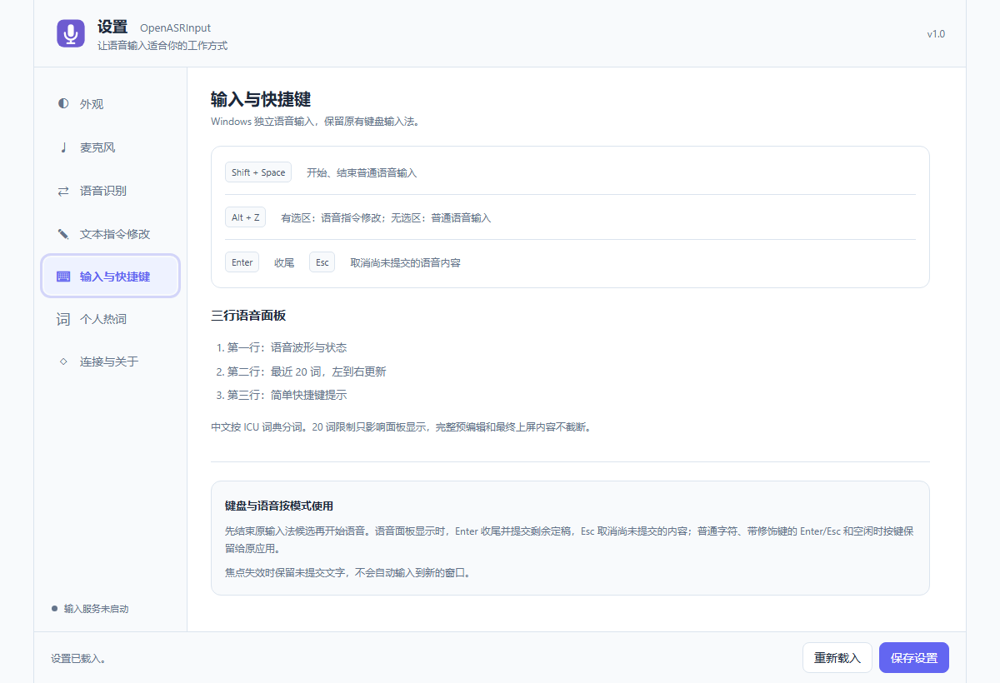
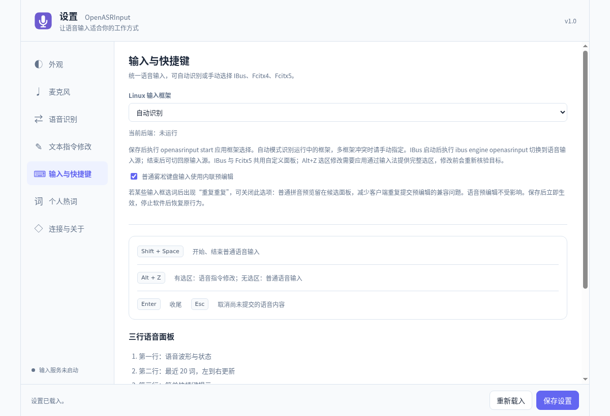

# OpenASRInput user guide

**English** | [简体中文](user-guide.zh-CN.md)

Version **1.0.0**. This guide covers first installation, daily dictation, selection editing, multiple services, and recovery. See [API](API.md) for integration and [development](development.md) for source builds. Licensed under [GPL v3](../LICENSE). English descriptions below retain key Chinese button labels where useful for locating controls in the current UI.

## 1. Logical architecture

### 1.1 What happens during dictation

```text
Microphone → Input capture / recording session → Portal → cloud ASR or LocalASR
                                                   ↓ recognition events
Active app ← native platform input bridge ← preedit, revisions, stable finals
```

Input records, previews, and commits at the cursor. Portal authenticates, selects an upstream, and returns unified results. LocalASR is optional local inference; cloud recognition does not require it.

The settings page, recording daemon, and native bridge have separate roles: **opening the page does not prove recording or native text delivery works**. Linux uses the desktop's IBus, Fcitx5, or Fcitx4; Windows uses the bundled native bridge. Input has no notes database and does not store text in Notes/Drafts.

### 1.2 Preview, final text, and cancellation

Recognition can revise repeatedly. New preedit replaces old preview; stable finals commit once. The panel shows recent text only: Linux's “20-word buffer” limits display, not the complete committed text. Already committed text belongs to the target document. Esc cancels uncommitted content in this round, not the whole document.

Capture starts before Portal is ready, buffering up to 30 seconds in memory. Connection errors or a full buffer stop recording and show an error. This is not long-term offline recording. After focus becomes invalid, pending text is never automatically redirected to another window.

### 1.3 Credentials

Ordinary dictation needs the **Portal HTTP(S) address and client ASR key**. Example: `http://127.0.0.1:10087`, without `/admin` or a WS path. The Portal administrator derives client keys under Downstream Clients (下游客户端).

Voice editing of selected text also needs a separate text-model card. Portal recognizes the spoken command, then **selection and instruction** are sent to that card's text model. Cloud ASR keys stay in Portal; text-model keys stay in Input. They are not interchangeable.

## 2. Installation and configuration

### 2.1 Choose and verify a package

Windows uses x64 MSI; Debian/Ubuntu Linux uses amd64 or ARM64 deb. `amd64` means ordinary Intel/AMD 64-bit PCs; `arm64` means ARM64 devices. Packages include private Python, so users need not install it separately.

Download the matching file and `SHA256SUMS`. Linux can run `sha256sum -c SHA256SUMS` in the download directory. If downloading only some attachments, verify those entries; missing other files does not mean the downloaded file is corrupt. On Windows:

```powershell
Get-FileHash .\OpenASRInput_1.0.0_windows_amd64_native.msi -Algorithm SHA256
```

Compare the same-name manifest entry. Preserve directories when extracting documentation; images live in `docs/images/`.

### 2.2 Windows installation and first run

1. Run `OpenASRInput_1.0.0_windows_amd64_native.msi` and complete the wizard.
2. Open OpenASRInput settings from Start. Standalone Input MSI does not include Portal; use your administrator's address for an existing remote Portal.
3. In Windows Settings → Privacy & security → Microphone, permit desktop apps and confirm the device is not muted in Sound settings.
4. Check the Portal card, microphone, and native bridge as described below.
5. Start Input, focus an ordinary text editor, press **Shift+Space**, speak briefly, press again to finish, and wait for stable text.



Real settings service extracted from the 1.0.0 MSI on Windows 11 amd64, using temporary configuration. This illustrates layout, not system installation, real microphone, or native commit acceptance. The pictured Alt+Z is an old static hint; **Windows text editing actually uses Alt+X**.

### 2.3 Linux installation and input frameworks

In the download directory (substitute the ARM64 file when appropriate):

```bash
sudo apt install ./OpenASRInput_1.0.0_linux_amd64_local-auto.deb
openasrinput settings
```

Under Input and Shortcuts (输入与快捷键), select the framework your desktop actually uses. Automatic detection usually works with one framework; explicitly choose IBus/Fcitx5/Fcitx4 when several exist. Save, then run:

```bash
openasrinput start
```

- **IBus:** add OpenASRInput in desktop input sources. After registration/start, `ibus engine openasrinput` can select it; switch back afterward if desired.
- **Fcitx5 / Fcitx4:** check OpenASRInput is loaded in the framework's configuration tool and test shortcuts within its input context. Selecting a webpage dropdown alone does not configure the system framework.
- **Fcitx4 is X11-only.** Wayland support depends on desktop, framework, and target app; cursor following and selection access vary.

If the desktop has not discovered a newly installed engine, save your work and sign in again as required by the desktop. The settings page itself does not install, restart, or replace your input-method setup. `demo` uses an in-memory context and cannot verify real commits.



Real Linux amd64 source settings page, captured without the input daemon. It shows framework controls, not acceptance of all X11/Wayland combinations. Capture-source details remain in [testing](testing.md).

### 2.4 First connection: follow this order

1. Open Speech Recognition → Add Portal Card (语音识别 → 新增 Portal 卡). Enter name, Portal address, and ASR key.
2. Leave recognition profile ID empty to follow Portal's default, or enter the exact ID provided by the administrator. An ID is not a display name/model name.
3. Click Test Status and Latency (测试状态与时延); verify authentication/profile queries. Save This Card (保存此卡), then Use This Portal (使用此 Portal), and check its active status.
4. Open Microphone, start with the system default, and refresh/select a device if needed. Calibration is in §3.3.
5. Check running status under Connection and About (连接与关于); on Linux also enable the selected framework.
6. Test one sentence in an ordinary editor. If page tests pass but no text arrives, follow §5 layer by layer.

## 3. Settings and everyday operation

### 3.1 Saving settings

Bottom Save Settings (保存设置) handles general appearance, device, quick connection, framework, and socket forms. Do not close the browser while “unsaved” is shown. Reload (重新载入) rereads saved values; resolve pending edits first.

Portal Save This Card / Use This Portal, text-model Save Model Card / Use This Model, Save Hotword Settings, and Apply Validated Configuration are independent operations. A successful test neither saves a card nor activates it.

Appearance updates running panels after saving. Microphone/Portal/text-model changes mainly apply next round. Socket paths require the next daemon startup; after saving an input framework, run `openasrinput start`. Finish recording before changing connections to make effects clear.

### 3.2 Appearance

Settings-page and input-panel themes are independent. Both offer GitHub, Material, Nord, Rosé Pine, and light/dark modes. Darkening the webpage does not necessarily change the panel.

| Setting                    | Selection guidance                                                                                     |
| -------------------------- | ------------------------------------------------------------------------------------------------------ |
| Panel position             | Follow cursor, fixed top/bottom/corners, or hidden; fixed positions generally use the target's monitor |
| Transparency               | 0 is opaque, 100 fully transparent; at 100 recording may continue with an invisible panel              |
| Panel scale / preview font | 80%–150%, 12–22 px; try 125% and 16–18 px on high-DPI screens                                          |
| Width / corner radius      | Width 480–960, radius 8–24; appearance preview does not use the microphone                             |

Without global cursor coordinates on Wayland, cursor-following falls back to the bottom of the screen; the compositor chooses layer-shell monitors. X11 transparency needs compositing support.

### 3.3 Microphone and automatic calibration

Refresh Devices (刷新设备) enumerates without recording. System Default suits frequently changed headsets; a fixed device suits a dedicated microphone but must be reselected after removal.

Calibration calls the active Portal, takes longer than level detection, and consumes recognition quota:

1. Save a working Portal connection, use your normal posture/distance/volume, and finish active dictation.
2. Click Start Microphone Calibration (开始麦克风校准), remain silent for three seconds, then read the displayed passage when prompted.
3. Click Finished Reading, Stop Recording (朗读完毕，结束录音). Wait while the same audio is compared with different gains and, when needed, a mild high-pass filter; candidates are retested.
4. When prompted, Record Independent Validation Passage (录制独立验证短文). This checks improvement beyond the first passage.
5. Click Apply Validated Configuration (应用验证后的配置) only when the page offers an applicable result. Without reliable improvement, existing settings remain. You may cancel midway.

Comparisons, retests, and validation commonly consume several minutes of ASR quota. Audio stays in task memory only. Recalibrate after changing microphone, distance, or environment, not on every startup.

Fallback input gain ranges 0.5–3 and applies when no calibration profile matches; a matching profile takes priority. Manual gain changes invalidate the old profile. Restore This Device's Manual Gain (恢复此设备的手动增益) reverts calibration. Digital gain cannot repair original clipping or remove ambient noise.

### 3.4 Speech recognition: multiple Portal cards

Each card independently stores name, address, key, profile ID, and test results. Use separate home/work cards and activate the desired card instead of repeatedly overwriting one address.

Test Status and Latency measures HTTP authentication/profile-query round trips, not first-word ASR latency. Diagnose failed tests by service/authentication/profile errors. A healthy service need not have a ready model.

Saved keys are not displayed and never automatically inherited by another card. Follow the card's “saved” indicator for blank-field behavior. A changed address needs the new service's key. Bottom Current Connection Quick Settings edits only the active card; Clear Saved Access Key explicitly clears it—do not infer clearing from an empty box.

Follow Portal Default selects the server default for new sessions; an explicit ID pins a profile. Disabling a pinned profile does not silently select another model. **Deleting a card removes only the local connection, not the Portal key.**

### 3.5 Text-command editing

Create a card in order: name → source → API address/key → model name → save → use. Official DeepSeek supplies its address/model catalog. OpenAI-compatible sources need a supported Chat Completions Base URL; refresh the model list or enter a name. A chat webpage is not an API address.

Test Availability (测试可用性) uses a fixed example and incurs a small model charge; a failed test does not prevent saving. Name, source, address, model, and key are required for a saved card. Disable Text Editing does not affect dictation.

Select text in the target app, press Linux **Alt+Z** / Windows **Alt+X**, speak an instruction such as “make this a shorter notice,” then press again to finish. The panel shows the command; completion replaces the original selection. Linux also supports Enter to finish and Esc to cancel. A changed target/selection must not be replaced. If an app cannot expose its selection, use ordinary dictation or a supported editor.

### 3.6 Input and shortcuts: a full dictation round

1. Finish any existing input-method candidate selection and place the cursor.
2. Press **Shift+Space**; confirm waveform/recording status.
3. Keep target focus while speaking. Changing preview is normal; do not repeatedly copy the same preview.
4. Press **Shift+Space** again and await final results/commits. On Linux, Enter finalizes; Esc cancels uncommitted content.
5. Check the target text before switching windows. After a target change/uncertain ACK, inspect the document before rerecording to avoid duplicates.

Voice mode may consume ordinary characters/edit keys during recording; resume keyboard editing afterward. Alt+Z/Alt+X without a selection may enter ordinary voice input. The old Windows Alt+Z screenshot hint is not authoritative.

Linux's “Use inline preedit for ordinary Wusong keyboard input” affects ordinary Pinyin only. If candidate selection duplicates text in some fields, disable/save it to keep Pinyin previews in the candidate panel. Voice preedit is unaffected; stopping the software restores original behavior.

### 3.7 Personal hotwords

1. Select/save the Portal card, open Personal Hotwords, and Refresh Portal Hotword Status (刷新 Portal 热词状态).
2. Enter a word, choose weight 1–5, and Add One; enable, disable, or delete individual entries.
3. Enable Hotword Enhancement (启用热词增强), then Save Hotword Settings (保存热词设置). Turning off the master switch preserves entries.
4. For suggestions, choose a public dictionary, Load into Candidates, search/add individual words, then save again.

The personal list supports 2,000 words. JSON downloads include word, weight, and enabled state. Import merges by word, taking file values for duplicates; saving synchronizes. Devices with the same key share this list. After a save conflict, refresh and merge instead of repeatedly overwriting.

Public dictionary updates do not rewrite saved personal words. Actual upstream use depends on capability/count limits. LocalASR currently does not support session-level personal hotwords; a successful save does not mean every engine uses them.

### 3.8 Connection and About

Inspect daemon status, recent errors, stop reason, launch command, and actual configuration path here. Recent Session Events diagnoses ordering without speech text or keys. Native bridge sockets connect local processes; normally retain defaults. They are not Portal network addresses.

## 4. Advanced configuration and workflows

### 4.1 Local, remote, and multiple devices

`127.0.0.1` means the current computer. Remote Portal connections use that server's HTTPS origin. Portal administrators configure Docker upstream addresses; Input does not connect directly to LocalASR port 10095.

Different users/devices needing separate quotas should get separate client keys. Devices sharing personal hotwords may share a key, but also share quota and revocation. Card switching affects the next round; an active session cannot migrate between services.

For self-signed deployments, establish trust using the administrator's public certificate. Browser access does not establish trust in Input's private Python. Check TLS names, validity, and runtime trust stores rather than permanently disabling verification.

### 4.2 Configuration and isolated instances

Defaults: Windows `%APPDATA%\OpenASRInput\input.json`; Linux `$XDG_CONFIG_HOME/openasrinput/input.json`, or `~/.config/openasrinput/input.json` without XDG. Connection and About shows the actual path.

`OPENASRINPUT_CONFIG` selects another configuration; `OPENASRINPUT_SOCKET` isolates the bridge. Use these for genuinely separate test instances and keep settings/daemon values consistent, or the page may save a different instance's settings. Configuration contains credentials; remove secrets before sharing.

### 4.3 Backup, upgrade, and recovery

1. Finish recording and exit Input.
2. Back up the actual configuration directory. Export personal hotwords separately; their server-side table belongs to Portal.
3. Install the new matching package; check active card, microphone, and framework.
4. Verify a short sentence through recognition and native delivery before normal use.

Moving configuration to another PC preserves connection details but may require new device IDs, sockets, and framework selections. Uninstalling software and deleting personal configuration are separate operations. Retain needed data before cleanup. For a replaced/leaked key, derive a new Portal key, update all devices, then revoke the old key.

## 5. Frequently asked questions

### The settings page will not open

Reopen it from the app menu. Check whether another instance occupies port 10088. With installed/source copies running together, compare configuration paths. Portal `/admin` is not Input settings.

### Connection test passes, but recording gives no text

The test checks gateway authentication/profile queries only. Check waveform, enabled profile/quota, and upstream availability; LocalASR must be ready. Retry a short sentence in a new session and record its explicit error, never reuse a finished session.

### Text appears in the panel but not the target

Check the selected Linux framework or running Windows bridge, editable target, and unchanged focus. If ordinary editors work but one app fails, investigate its input/selection capabilities or privilege differences. Settings captures/demo do not prove native delivery.

### Audio is quiet/noisy, or calibration does not improve it

Select a real microphone rather than loopback; check OS input level, distance, and mute. Lower hardware level for clipping. Retaining settings when calibration finds no reliable gain is normal. Increasing digital gain cannot compensate for unsuitable acoustics.

### Shortcuts do nothing or conflict

Dictation is Shift+Space; text editing is Linux Alt+Z / Windows Alt+X. Finish candidate selection, confirm focus/running status, then check OS/other-app shortcut conflicts. Old UI hints do not imply arbitrary shortcut remapping.

### Saved hotwords still fail, or devices overwrite each other

Check active card/key, master switch, and per-word enablement. The upstream may lack support or select only some entries. Same-key devices share a list: refresh before editing; request separate keys for separate lists.

### Finalization stalls or the target changes: should I submit again?

Inspect text already delivered, retain uncommitted panel text, and check the stop reason in Connection and About. Do not repeatedly send/rerecord to guess success. Start a new round after network/target recovery; undo duplicates in the target app if needed.

Reports should include OS, X11/Wayland/framework, target app, reproduction steps, and sanitized errors. Do not publish real keys, personal recordings, or whole configuration files. See [testing](testing.md) for platform acceptance scope.
