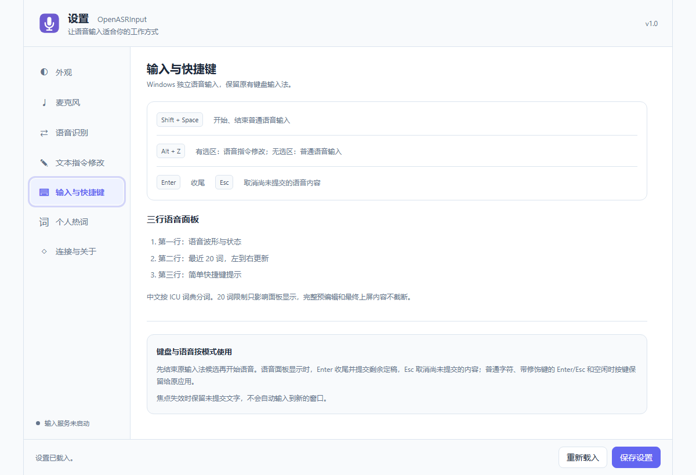
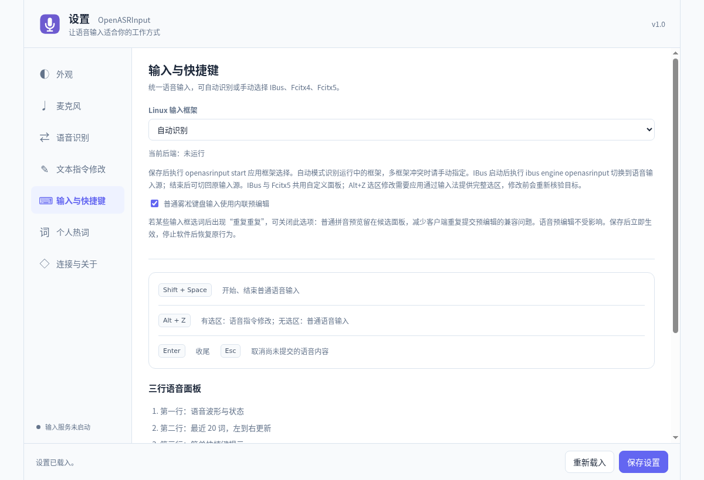

# OpenASRInput 使用手册

[English](user-guide.md) | **简体中文**

适用版本：**1.0.0**。本手册从首次安装讲到日常听写、选区修改、多服务切换和故障恢复。接口开发见 [API](API.zh-CN.md)，源码构建见 [开发说明](development.zh-CN.md)。项目采用 [GPL v3](../LICENSE)。

## 1. 软件的逻辑架构

### 1.1 一次听写经过哪些环节

```text
麦克风 → Input 采集与录音会话 → Portal → 云 ASR 或 LocalASR
                                  ↓ 识别事件
当前应用 ← 平台原生输入桥接 ← 预编辑、修订和稳定定稿
```

Input 负责录音、显示预览和向光标所在位置提交文字。Portal 负责鉴权、选择识别上游和返回统一结果。LocalASR 是可选的本地推理服务；使用云识别时不必安装它。

设置网页、录音守护进程和原生输入桥接各有职责：**网页能打开，不代表录音或原生上屏已经可用**。Linux 使用当前桌面的 IBus、Fcitx5 或 Fcitx4；Windows 使用随包安装的原生桥接。Input 没有笔记数据库，也不把文字存入 Notes 或 Drafts。

### 1.2 预览、定稿与取消

识别中的文字可能反复修订；原生预编辑区域用新结果替换旧结果，稳定定稿才提交一次。面板只展示最近一段文字，Linux 的“20 词缓冲”是显示范围，完整上屏内容不会因此截断。已经提交到应用的部分属于目标文档；Esc 取消本轮尚未提交部分，不是撤销整段文档的快捷键。

录音开始后先采集，Portal 未就绪时可在内存暂存最多 30 秒音频；连接错误或缓存满会停止并提示。此机制不能代替长期断网录音。焦点失效后，未提交文字不会自动转投另一个窗口。

### 1.3 需要准备的凭据

普通听写只需 **Portal 的 HTTP(S) 地址和客户端识别 Key**。地址示例为 `http://127.0.0.1:10087`，不带 `/admin` 或 WebSocket 路径。识别 Key 由 Portal 管理员在“下游客户端”派生。

选区语音修改还需独立的文本模型卡：语音指令先经过 Portal 识别，再把**选区文字与指令**送给卡片指定的文本模型。云 ASR Key 留在 Portal，文本模型 Key 留在 Input 模型卡，两者不能混用。

## 2. 安装与配置

### 2.1 选择安装包并核对下载

Windows 使用 x64 MSI；Linux Debian/Ubuntu 系使用 amd64 或 ARM64 deb。`amd64` 对应常见 Intel/AMD 64 位电脑，`arm64` 对应 ARM64 设备。安装包携带 Input 私有 Python，普通用户无需另外安装 Python。

从发行目录取对应文件及 `SHA256SUMS`。Linux 可在下载目录运行 `sha256sum -c SHA256SUMS`；只下载了部分附件时，只核对所需文件，缺少其他文件不表示已下载文件损坏。Windows 用 PowerShell：

```powershell
Get-FileHash .\OpenASRInput_1.0.0_windows_amd64_native.msi -Algorithm SHA256
```

将输出与清单的同名条目比较。完整文档 ZIP 解压时保留目录结构，图片在 `docs/images/`。

### 2.2 Windows 安装与首次启动

1. 运行 `OpenASRInput_1.0.0_windows_amd64_native.msi`，按向导完成安装。
2. 从开始菜单打开 OpenASRInput 设置。独立 Input MSI 不包含 Portal；已有远程 Portal 的用户直接使用管理员提供的地址。
3. 在 Windows“设置 → 隐私和安全性 → 麦克风”允许桌面应用访问麦克风，并在系统声音设置确认设备未静音。
4. 按下文完成 Portal 卡、麦克风、原生桥接状态三项检查。
5. 启动 Input，在普通文本编辑器点出光标后，按 **Shift+Space** 说一句短语，再按一次结束，等待最后文字稳定。



图为 Windows 11 amd64 上从 1.0.0 MSI 解包运行的真实设置服务，使用临时配置。它展示页面布局；没有在本图演示系统级安装、真实麦克风或原生上屏。图中 Alt+Z 是静态旧提示，**Windows 实际文本修改键为 Alt+X**。

### 2.3 Linux 安装与输入框架启用

在下载目录执行（ARM64 换成相应文件）：

```bash
sudo apt install ./OpenASRInput_1.0.0_linux_amd64_local-auto.deb
openasrinput settings
```

在“输入与快捷键”选择当前桌面正在使用的框架；只有一个框架时通常可用“自动识别”。存在多个框架时明确选 IBus、Fcitx5 或 Fcitx4，保存设置后执行：

```bash
openasrinput start
```

- **IBus**：在桌面输入源列表添加 OpenASRInput；引擎注册并启动后也可用 `ibus engine openasrinput` 切换，用完可切回原输入源。
- **Fcitx5 / Fcitx4**：在相应框架的配置工具中检查 OpenASRInput 已加载，并在该框架的输入上下文内验证快捷键。不要只修改网页下拉框就认为系统框架已配置完成。
- **Fcitx4 仅适用于 X11**。Wayland 的可用性取决于桌面、输入法和目标应用；跟随光标、选区读取等能力不完全相同。

新安装引擎尚未被桌面发现时，保存工作后按桌面要求重新登录。设置页面本身不会安装、重启或替换你的输入法方案。不要以 `demo` 作为真实上屏验证，demo 仅使用内存输入上下文。



图为 Linux amd64 源码设置服务的真实页面，未启动输入守护进程。它说明框架选项的位置，不代表所有 X11/Wayland 组合已验收。

### 2.4 首次连接：按此顺序完成

1. 进入 **语音识别 → 新增 Portal 卡**，填卡名称、Portal 地址、识别 Key。
2. “识别配置 ID”先留空以跟随 Portal 默认；若管理员给了指定 ID，照实填写。ID 不是显示名称或模型名。
3. 点 **测试状态与时延**，检查鉴权与档案查询成功；点 **保存此卡**，再点 **使用此 Portal**，确认卡片显示当前使用状态。
4. 进入 **麦克风**，先用系统默认设备；需要时刷新并指定设备。自动校准按第 3.3 节操作。
5. 进入 **连接与关于**，确认运行状态；Linux 再确认所选框架已启用。
6. 在普通编辑器测试一句话。若只有页面测试成功而没有文字，按第 5 节逐层检查。

## 3. 设置页面与具体使用

### 3.1 如何保存设置

底部 **保存设置** 用于外观、设备、快捷连接、框架和 socket 等通用表单；出现“未保存”时不能只关浏览器。**重新载入** 会重新读取已保存值，先处理不想丢失的表单修改。

Portal 卡的“保存此卡 / 使用此 Portal”、文本模型卡的“保存模型卡 / 使用此模型”、个人热词的“保存热词设置”、校准的“应用验证后的配置”各自执行独立操作。测试成功不等于已保存，也不等于已切换为当前卡。

外观保存后可实时更新运行中的面板；录音设备、Portal 和文本模型的更改主要用于下一轮；socket 路径需下次启动守护进程，输入框架保存后要执行 `openasrinput start`。在录音收尾完成后再调整连接最容易核对效果。

### 3.2 外观

“设置页面主题”与“输入面板主题”独立，都支持 GitHub、Material、Nord、Rosé Pine 和亮/暗模式。设置网页变暗不必然改变输入面板，需分别设置。

| 项目                | 如何选择                                                                      |
| ------------------- | ----------------------------------------------------------------------------- |
| 面板位置            | 可跟随光标、固定在屏幕上下/四角或不显示；多屏固定位置通常跟随输入目标所在屏幕 |
| 透明度              | 0 为不透明，100 为完全透明；误设 100 会看不到面板，但录音仍可能进行           |
| 面板缩放 / 预览字号 | 缩放 80%–150%，字号 12–22 px；高分屏可先用 125% 与 16–18 px                   |
| 宽度 / 圆角         | 宽度 480–960、圆角 8–24；预览只是外观示例，不访问麦克风                       |

Wayland 缺少全局光标坐标时，“跟随光标”会退回屏幕下方；layer-shell 的屏幕选择由合成器控制。X11 透明度需要桌面合成器支持。

### 3.3 麦克风与自动校准

**刷新设备**只枚举设备，不开始录音。“系统默认设备”适合经常切换耳机的用户；指定设备适合固定麦克风，但拔出后需重新选择。

自动校准会调用当前 Portal，比单纯电平检测更耗时，也会产生识别用量：

1. 先保存可用 Portal 连接，保持平时坐姿、距离和音量，关闭正在进行的听写。
2. 点 **开始麦克风校准**，先安静三秒，出现朗读提示后再读页面短文。
3. 朗读结束点 **朗读完毕，结束录音**；等待程序对同一录音比较增益和必要的轻度高通，并复测候选。
4. 页面要求时点 **录制独立验证短文**，按新的提示录音。独立验证用于确认改善不是只对第一篇短文有效。
5. 仅在页面给出可应用结果时点 **应用验证后的配置**。没有可靠改善会保留当前设置；途中可取消。

同一录音的多次比较、复测和验证通常产生数分钟识别用量，音频仅在本次任务内存中使用。切换麦克风、距离或环境后再考虑校准，不必每次启动都做。

“备用输入增益”范围 0.5–3，未匹配校准档案时使用；匹配档案优先。手工改变增益会使旧档案失效；**恢复此设备的手动增益**可撤回校准设置。数字增益不能修复麦克风原始削波，也不能消除环境噪声。

### 3.4 语音识别：多张 Portal 卡

每张卡独立保存名称、地址、识别 Key、配置 ID 和测试结果。家庭与工作服务可以各建一张，切换时点“使用此 Portal”，不要反复覆盖同一张卡的地址。

“测试状态与时延”测的是网关鉴权和配置查询的 HTTP 往返时间，不能作为识别首字时延。测试失败仍应根据错误检查服务、认证和档案；服务健康不代表模型就绪。

已保存 Key 不回显，不会自动继承到另一张卡。编辑时留空如何处理以卡片“已保存”的提示为准；换地址时应明确使用新服务对应的 Key。底部“当前连接快捷设置”只修改当前卡；其“清除已保存的接入 Key”才用于主动清除，而不是用空框猜测。

选择“跟随 Portal 默认”让新会话采用服务端默认档案；指定 ID 则固定到该档案。被固定的档案停用时不会自动换成别的模型。**删除卡片只删除本机连接，不撤销 Portal 里的识别 Key**。

### 3.5 文本指令修改

新增卡按“名称 → 来源 → API 地址与 Key → 模型名称 → 保存 → 使用”操作。DeepSeek 官方来源提供官方地址与模型目录；OpenAI 兼容来源填写服务支持的 Chat Completions Base URL，可刷新模型列表，也可手填模型名。不要将聊天网页地址当作 API 地址。

**测试可用性**使用固定例子，会产生少量文本模型调用费用；测试失败不阻止保存。卡片必须具备名称、来源、地址、模型和 Key 才能加入已保存列表。“停用文本修改”不影响普通听写。

实际操作：在目标应用选中一段文字，按 Linux **Alt+Z** / Windows **Alt+X**，说“把这段话改成更简短的通知”之类指令，再按同一快捷键结束，等待处理。指令显示在面板，完成后替换原选区。Linux 也可 Enter 收尾、Esc 取消。目标或选区变化时不应替换；应用无法提供完整选区时改用普通听写或在支持的编辑器操作。

### 3.6 输入与快捷键：一轮完整听写

1. 先结束原输入法的候选选择，在需要输入的位置点出光标。
2. **Shift+Space** 开始普通听写，确认波形与录音状态。
3. 保持目标焦点说话；看到预览变化属于正常修订，不要把同一句预览复制多次。
4. 再次 **Shift+Space** 结束，等待最终结果与提交完成。Linux 的 Enter 可正常收尾，Esc 取消尚未提交内容。
5. 在目标应用检查文字后再切窗口。目标变化或 ACK 未确认时先核对实际文档，避免盲目重录造成重复。

录音中普通字符与编辑键可能由语音模式消费，结束后再继续键盘编辑。Alt+Z/Alt+X 没有选区时可进入普通语音输入；静态截图中的 Windows Alt+Z 提示不能作为实际键位依据。

Linux 的“普通雾凇键盘输入使用内联预编辑”只针对普通拼音预览；若某些输入框选词后重复，可关闭并保存，让普通拼音预览留在候选面板。语音预编辑不受该项影响，停止软件后恢复原行为。

### 3.7 个人热词

1. 先选好并保存 Portal 卡，进入“个人热词”点 **刷新 Portal 热词状态**。
2. 输入词语，权重选 1–5，点“新增一条”；逐词可启用、停用或删除。
3. 勾选 **启用热词增强**，点 **保存热词设置**。总开关关闭保留词条，只暂停使用。
4. 需要推荐词时选择公共表，点“加载到候选区”，搜索后逐词“加入热词表”，最后再次保存。

个人表最多 2000 词。下载 JSON 包含词语、权重和启用状态；导入按词语合并，同名词采用文件值，保存才同步。多个设备共用同一 Key 就共用这张表，保存冲突时刷新最新版本再合并，不连续覆盖。

公共表更新不会自动改写已保存个人词。是否真正传给识别上游还取决于能力与数量限制；LocalASR 当前不支持会话级个人热词，保存成功不等于所有引擎都会使用。

### 3.8 连接与关于

这里查看守护进程状态、最近错误、停止原因、启动命令和实际配置文件路径。“最近会话事件”用于诊断状态顺序，不含语音正文与 Key。原生桥接 socket 是本机进程之间的连接，普通用户通常保持默认；它不是 Portal 网络地址。

## 4. 额外配置与复杂使用

### 4.1 本机、远端与多设备

本机地址的 `127.0.0.1` 指当前电脑；远端 Portal 要填该服务器的 HTTPS origin。若 Portal 的上游在 Docker 内，容器网络地址由 Portal 管理员配置，Input 不直接填写 LocalASR 的 10095 地址。

不同使用者或需单独额度的设备应使用不同客户端 Key；希望共用个人热词的设备可共用同一 Key，但同时共用额度与撤销状态。Input 多卡切换只影响下一轮，不能在一轮录音中途迁移会话。

自签名部署要按管理员提供的公有证书建立信任。浏览器能打开管理页不代表 Input 私有 Python 的信任链也完整；遇到 TLS 错误核对名称、有效期和运行时证书库，不用关闭验证作为长期配置。

### 4.2 配置文件与隔离实例

默认配置文件为 Windows `%APPDATA%\OpenASRInput\input.json`，Linux `$XDG_CONFIG_HOME/openasrinput/input.json`（未设 XDG 时为 `~/.config/openasrinput/input.json`）。以“连接与关于”显示的路径为准。

`OPENASRINPUT_CONFIG` 可指定另一份配置，`OPENASRINPUT_SOCKET` 用于隔离桥接。只在确实需要独立测试实例时改用这些入口，且保持设置进程与守护进程一致；否则会出现“网页保存了，但实际录音没变”的现象。配置包含连接凭据，复制给他人前先移除秘密。

### 4.3 备份、升级和恢复

1. 结束当前录音并退出 Input。
2. 备份实际配置目录；个人热词另从页面导出，服务器端表属于 Portal 数据。
3. 安装对应平台的新包，启动后核对当前 Portal 卡、麦克风和输入框架。
4. 用短句检查识别与原生上屏，再恢复日常使用。

恢复到另一台电脑可沿用连接信息，但设备 ID、socket 与输入框架可能不同，应重新选择。卸载软件与删除个人配置是不同操作，保留需要的数据后再明确清理。更换或泄露 Key 时在 Portal 派生新 Key，更新所有使用设备后撤销旧 Key。

## 5. 常见问题与解答

### 设置网页打不开怎么办？

先从应用菜单重新打开设置，查看是否已有实例占用设置端口（默认 10088）。安装版本与源码版本同时运行时核对它们的配置路径。不要把 Portal 的 `/admin` 当作 Input 设置页。

### 测试连接成功，为什么录音没有文字？

测试只验证网关鉴权与配置查询。继续检查麦克风波形、Portal 档案是否启用且有额度、上游模型是否可用；LocalASR 必须 ready。用短句重试，记录本轮明确错误，不复用已经结束的会话。

### 文字在面板里，但目标应用没有收到？

确认 Linux 正在使用所选输入框架、Windows 桥接已运行，且目标是可编辑控件、焦点未变。普通编辑器可用而特定应用失败时，说明需检查该应用的输入/选区能力或权限差异。设置页截图和模拟 demo 都不能证明原生输入成功。

### 麦克风很小声、全是噪声或校准没有提升？

先确认选中的是真实麦克风而非回放设备，检查系统输入音量、距离与静音。削波先降硬件输入音量；校准无可靠改善保留原设置是正常结果。不要不断放大数字增益去补偿不合适的拾音环境。

### 按键没有反应或与其他软件冲突？

普通听写为 Shift+Space；文本修改 Linux Alt+Z、Windows Alt+X。先结束输入法候选，确认焦点和 Input 运行状态，再检查系统/其他应用是否占用组合键。界面旧提示不表示可以任意更换键位。

### 热词保存了仍识别错，或者不同设备互相覆盖？

核对当前卡、Key、总开关和逐词启用；上游可能不支持或只选取部分词。多设备同 Key 是共享表，先刷新再编辑；确需独立表则由管理员分配不同 Key。

### 收尾卡住或切窗口后提示目标变化，应该重复提交吗？

先检查目标里已经收到多少文字，保留面板中的未提交内容，查看“连接与关于”的停止原因。不要连续按发送/重录来猜测是否成功。网络或目标恢复后开启新一轮，必要时在目标应用自行撤销重复文字。

反馈问题时提供系统版本、X11/Wayland 与输入框架、目标应用、触发步骤和脱敏错误。真实 Key、个人录音和整份配置不应随公开问题上传。平台验收范围见 [测试说明](testing.zh-CN.md)。
